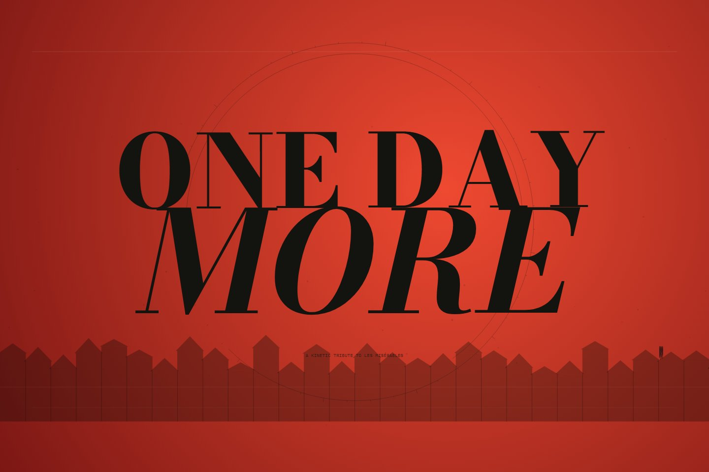

# ONE DAY MORE — A Kinetic Tribute

[](https://github.com/hslcrb/onedaymore_codexmotiongraphic/actions/workflows/ci.yml)



레미제라블의 「One Day More」에서 출발한 3분 55초 분량의 인터랙티브 키네틱 타이포그래피 작품. 검은 잉크, 아이보리 활자, 혁명의 붉은색으로 일곱 인물의 감정을 하나의 내일로 모읍니다. 활자는 글자 단위로 들어오며, 음원 시간에 따라 장면이 전환됩니다.

## 실행

```powershell
git clone https://github.com/hslcrb/onedaymore_codexmotiongraphic.git
```

```powershell
cd onedaymore_codexmotiongraphic
```

Node.js 20.19 이상 또는 22.12 이상. 명령은 각각 따로 실행합니다.

```powershell
npm install
```

```powershell
npm run dev
```

[감상 화면 열기](http://127.0.0.1:5173/)

## 음악

- 기본: [TUNE — One Day More, 25th Anniversary Concert](https://www.youtube.com/watch?v=wNNBrg4u9d0). YouTube 공연 플레이어를 화면에 표시하며 실제 재생 시간과 영상을 동기화합니다. 인터넷 연결 및 해당 지역/브라우저의 YouTube 재생 허용이 필요합니다. 광고·버퍼링 중에는 영상 시간이 임의로 진행되지 않습니다.
- **SOUND → Your recording**: 소장한 MP3/WAV/M4A 등을 선택하면 파일 길이에 맞춰 8개 장면을 재생합니다. 파일은 서버에 업로드되지 않습니다. 다른 녹음본은 공연의 프레이징과 장면 간격이 다를 수 있습니다.
- **SOUND → Before the dawn**: 인터넷 없이 재생하는 별도 창작 기악곡. 피아노, 저음 현악 질감, 타악기와 종소리를 Web Audio로 합성합니다. 「One Day More」 원곡이나 그 녹음이 아닙니다.

원곡의 작곡·작사와 공연 영상의 권리는 각 권리자에게 있습니다. 본 작품은 비공식 예술 헌정작입니다. 화면 문구는 가사 전체를 전사하지 않고 작품의 주제를 새로 표현한 문장입니다. 외부 폰트 연결이 안 되면 시스템 폰트로 표시합니다.

## 조작

| 조작 | 기능 |
| --- | --- |
| Enter the story / ▶ | 재생·일시정지 |
| 타임라인 / Chapters | 재생 위치·장면 선택 |
| Space | 재생·일시정지 |
| ← / → | 5초 이동 |
| M | 음소거 |
| F | 전체 화면 |
| Sound | 음악 선택·볼륨·부드러운 움직임 모드 |
| 좌상단 M 로고 | 처음 화면 |

## 장면

I The eve → II A fugitive → III Two hearts → IV Alone → V The barricade → VI The pursuit → VII All as one → VIII Tomorrow.

## 검증·빌드

```powershell
npm test
```

```powershell
npm run build
```

`dist/`를 정적 호스팅에 올릴 수 있습니다. 이 폴더는 상위 Next.js 프로젝트와 분리된 Vite 프로젝트이며, 상위 PostCSS 플러그인 없이 빌드됩니다. `scripts/browser-check.cjs`는 이 Codex 환경의 Playwright와 Edge를 사용하는 작성자용 브라우저 검증 도구입니다.

## 구성

- `src/renderer.js`: 글자별 등장, 장면 전환, 입자, 바리케이드와 합창 화면.
- `src/timeline.js`: 8개 장면과 재생 시간 제어.
- `src/audio.js`: YouTube·로컬 음원·Web Audio 창작 기악곡.
- `src/main.js`, `src/style.css`: 재생 컨트롤, 키보드, 반응형 화면.
- `tests/`: 타임라인 및 음원 전환 회귀 테스트 9개.
- `docs/`: 디자인, 구현 계획, 검증 기록, 작품 이미지.
- `OneDayMore.zip`: 실행 소스와 프로덕션 빌드 패키지.

GitHub Actions에서 Node.js 22로 테스트와 프로덕션 빌드를 검사합니다. 의존성과 임시 캡처는 커밋에서 제외하고, 작품 이미지와 소스는 저장소에 포함합니다. 원곡 음원 파일은 저장소에 포함하지 않으며 공연 플레이어로 연결합니다.
